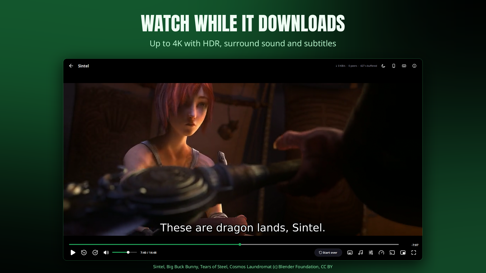
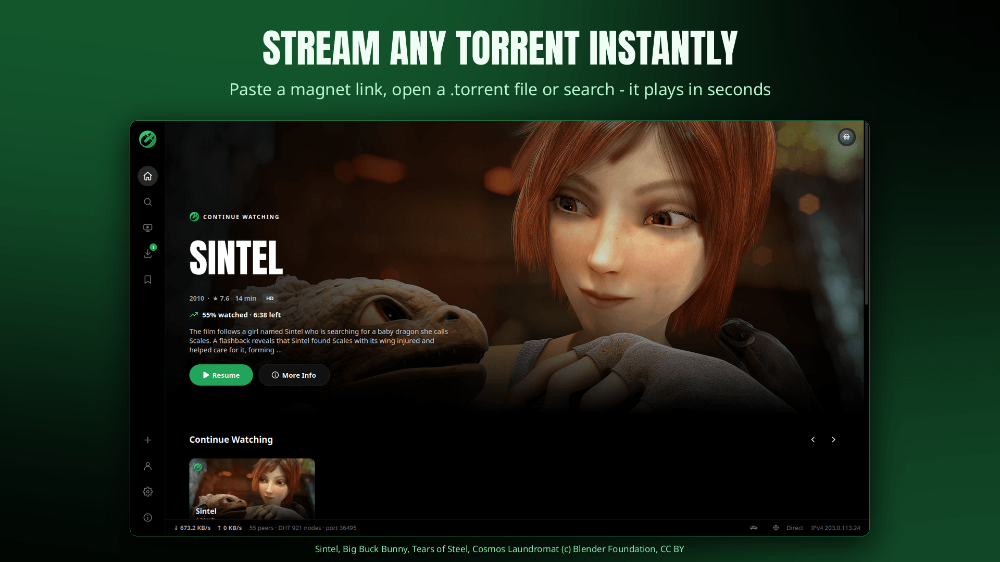
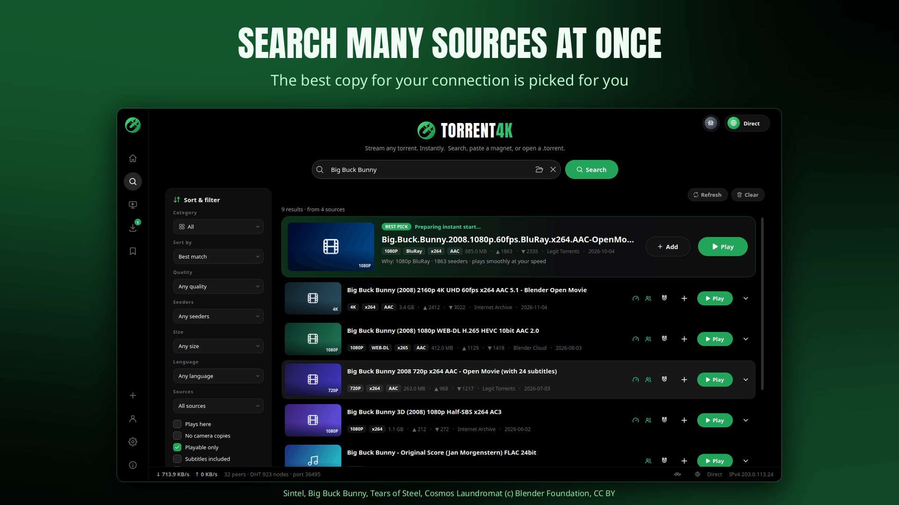
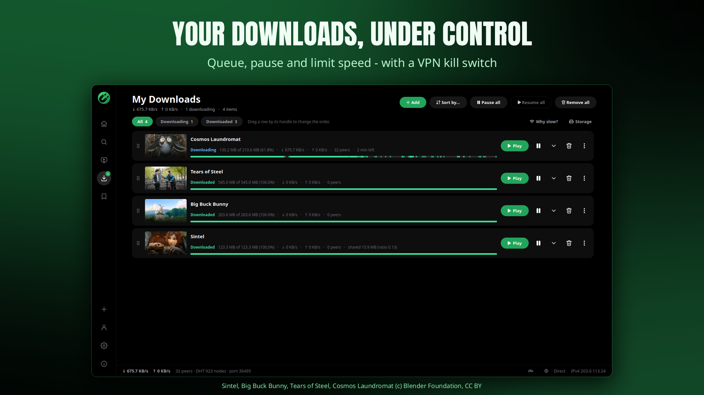
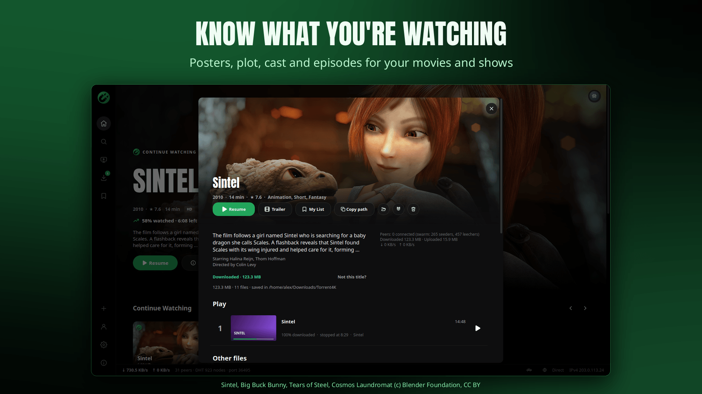

<h1 align="center">
  <br>
  Torrent4K: Stream Torrents While They Download
</h1>

<p align="center">
  <b>A torrent client and 4K video player in one. Open a magnet link and start watching in seconds.</b><br>
  For Windows 10 and 11, Ubuntu, Fedora, Debian, Linux Mint, Arch and any other Linux.
</p>

<p align="center">
  <a href="https://snapcraft.io/torrent4k"></a>&nbsp;
  <!-- not released yet - uncomment when it is:
  <a href="https://flathub.org/apps/com.warlordsoftwares.torrent4k"></a>&nbsp;
  -->
  <a href="https://github.com/rishabh3354/TORRENT4K/releases/latest/download/Torrent4K.exe"></a>&nbsp;
  <a href="https://github.com/rishabh3354/TORRENT4K/releases/latest/download/Torrent4K-x86_64.AppImage"></a>
</p>

<p align="center">
  
</p>

**Torrent4K** opens a magnet link, a .torrent file or a search result and starts the video in seconds, while the
rest downloads in the background. The built-in [mpv](https://mpv.io) player plays every codec, HDR and surround
sound format, so there's nothing else to install. It's also a full torrent client, with a download queue, speed
limits and a VPN kill switch.

## Install on Linux

### Snap (Ubuntu and most distributions)

```bash
sudo snap install torrent4k
```

Optional permission (the app works without it). It lists your VPN interface for the kill switch:

```bash
sudo snap connect torrent4k:network-observe
```

<!-- Flathub: uncomment when the app is published there
### Flatpak (Fedora, Linux Mint, Pop!_OS, elementary OS, Arch and more)

```bash
flatpak install flathub com.warlordsoftwares.torrent4k
```
-->

### AppImage (any distribution, no install)

Runs on Ubuntu 22.04 and newer, Debian 12, Fedora, Linux Mint, Arch and most other distributions. The player is
inside, so nothing else is needed.

```bash
wget https://github.com/rishabh3354/TORRENT4K/releases/latest/download/Torrent4K-x86_64.AppImage
```

```bash
chmod +x Torrent4K-x86_64.AppImage && ./Torrent4K-x86_64.AppImage
```

## Install on Windows

Torrent4K runs on **Windows 10 and Windows 11** (64-bit).

1. **[Download Torrent4K.exe](https://github.com/rishabh3354/TORRENT4K/releases/latest/download/Torrent4K.exe)**
   (or pick a version from [all releases](https://github.com/rishabh3354/TORRENT4K/releases)).
2. Run it and follow the setup steps. Torrent4K appears in the Start menu, and can open magnet links and
   .torrent files.

If Windows SmartScreen shows "Windows protected your PC", click **More info → Run anyway**.

## Features

| Watch | Find | Download |
| --- | --- | --- |
| Play while it downloads, seek anywhere | Search several public indexes at once | Queue, pause, reorder |
| Subtitles online, auto sync, dual subtitles | Best copy for your connection | Choose episodes |
| Next episode, skip intro and credits | Posters, episodes, similar titles | Speed limits and slow mode |
| Cast to Chromecast / DLNA, phone remote | My List: follow shows and RSS feeds | VPN kill switch, SOCKS5 proxy |
| Picture-in-picture, picture and sound settings | | Disk guard, private mode, backup |

20 languages, black, dark and light themes.

## Screenshots

| | |
| --- | --- |
|  |  |
|  |  |

<sub>The films shown are Blender open movies (CC BY, Blender Foundation) and public-domain films.</sub>

## FAQ

**Can I watch a torrent before it finishes downloading?** Yes. The pieces you are about to watch download first,
so the video starts in seconds, and seeking fetches that part next.

**Does it open magnet links from my browser?** Yes. Torrent4K registers for magnet links and .torrent files.

**Can I stream to my TV?** Yes, to Chromecast and DLNA TVs, while the torrent is still downloading (PRO).

**Can I use it with a VPN?** Yes. The kill switch binds torrent traffic to your VPN interface, so if the VPN
drops, the torrents stop. A SOCKS5 proxy works too.

## Free and PRO

- **Free:** play, stream and download at any quality and speed, with subtitles, the kill switch and parental lock.
- **PRO:** casting, phone remote, picture-in-picture, subtitle sync and more, with a one-time payment.
  See [plans and pricing](https://warlordsoftwares.com/apps/plans-and-pricing/?product=TORRENT4K).

## Support and feedback

- Found a bug or want a feature? [Open an issue](https://github.com/rishabh3354/TORRENT4K/issues).
- Questions about PRO or your account: [contact us](https://warlordsoftwares.com/contact-us/).

Only download and share content you have the right to.

---

<p align="center">
  Made by <a href="https://warlordsoftwares.com">Warlord Softwares</a> ·
  <a href="https://rishabh3354.github.io/TORRENT4K/">Website</a> ·
  <a href="share/license/LICENSE">License</a>
</p>

<sub>Torrent4K includes the mpv player (GPLv2+, <a href="https://github.com/mpv-player/mpv">source</a>) and
libtorrent (BSD), each under its own licence.</sub>
